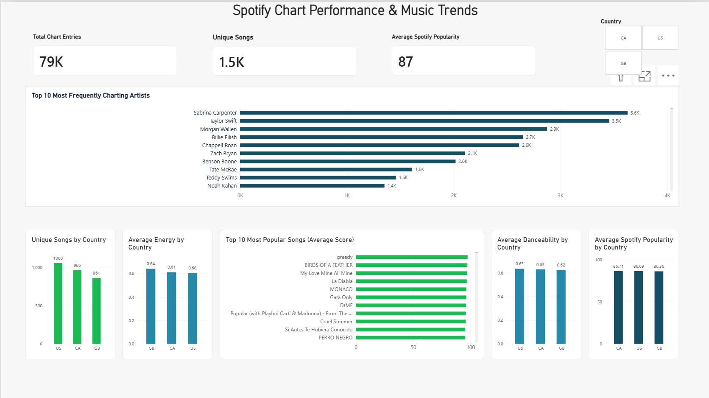

# Spotify Chart Performance & Music Trends

## Overview
This project analyzes Spotify chart data across the United States, Canada, and the United Kingdom to explore song popularity, artist performance, and music characteristics. Using SQL and Power BI, the project examines chart appearances, popularity, energy, and danceability across different markets.

## Dashboard Preview

## Key Metrics
- Total Chart Entries
- Unique Songs
- Average Spotify Popularity

## Analysis
- Top 10 Most Frequently Charting Artists
- Unique Songs by Country
- Average Energy by Country
- Top 10 Most Popular Songs
- Average Danceability by Country
- Average Spotify Popularity by Country

## Tools Used
- **SQL** — Data querying, aggregation, and analysis
- **Power BI** — Interactive dashboard development and visualization
- **CSV** — Dataset preparation and analysis

## Key Objectives
- Compare Spotify chart performance across countries
- Identify frequently charting artists
- Examine song popularity across different markets
- Analyze musical characteristics including energy and danceability
- Explore differences in chart trends between the US, Canada, and UK

## Files
- `Dashboard/` — Power BI dashboard (.pbix)
- `Screenshots/` — Dashboard preview image
- `SQL/` — SQL queries used for analysis
- `Data/` — Dataset files, if included

## Dataset
Spotify chart data containing song, artist, country, popularity, and musical characteristic information used for comparative analysis across selected markets.